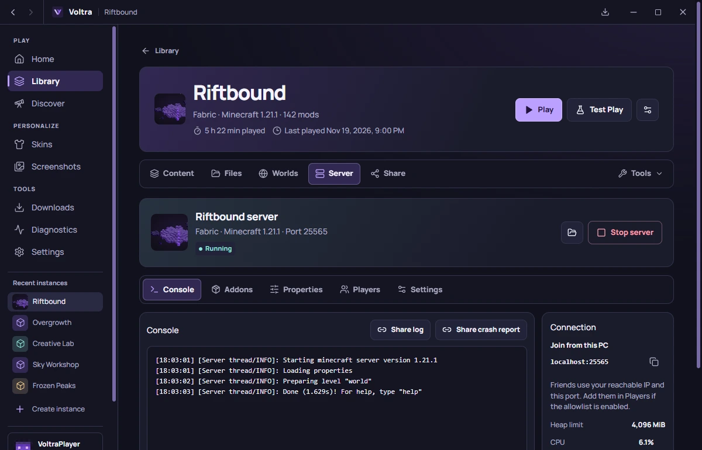

<h1 align="center">
  
</h1>

<p align="center">Open-source launcher for modded Minecraft Java Edition.</p>

<p align="center">
  <a href="https://github.com/zwroe/Voltra/releases"><strong>Releases</strong></a>
  &nbsp;·&nbsp;
  <a href="https://voltra.lol/docs/#install">User guide</a>
  &nbsp;·&nbsp;
  <a href="https://voltra.lol/docs/#build">Developer guide</a>
</p>


## Install

Get the installer for your system from [GitHub Releases](https://github.com/zwroe/Voltra/releases).

| System | Download |
| --- | --- |
| Windows x64 | `-windows-x64-setup.exe` |
| macOS | `-macos-arm64.dmg` for Apple silicon or `-macos-x64.dmg` for Intel |
| Linux x64 | `-linux-x64.deb` for Debian and Ubuntu, or the `.AppImage` |

macOS builds are ad hoc signed and may need to be allowed in **System Settings → Privacy & Security** the first time they open. On Linux, make the AppImage executable before opening it.

## Features

- Browse mods, modpacks, shaders, and resource packs from Modrinth and CurseForge. Filter by Minecraft version and loader.
- Keep each instance’s mods, settings, and saves separate. Run Vanilla, Fabric, Quilt, Forge, and NeoForge with managed Java.
- Take pack snapshots, test changes in a temporary instance, and inspect launch logs.
- Host a Vanilla or Fabric server from an instance and manage players, add-ons, and the live console.

| Discover | Server manager |
| --- | --- |
| [](docs/images/voltra-discover.webp) | [](docs/images/voltra-server.webp) |

## Build from source

Use Node.js 22 or newer, Rust, and the [Tauri prerequisites for your operating system](https://v2.tauri.app/start/prerequisites/).

```sh
npm ci
npm run tauri dev
```

Build an installer on its target OS with `npm run tauri -- build --bundles nsis` on Windows, `npm run tauri -- build --bundles dmg` on macOS, or `npm run tauri -- build --bundles deb,appimage` on Linux.

For a GitHub release, set the approved Microsoft application's client ID as the repository Actions secret `VOLTRA_MICROSOFT_CLIENT_ID`. Push a version tag matching `src-tauri/tauri.conf.json` (for example, `v1.0.0`). The release workflow builds and tests the installers, then attaches them and their SHA-256 checksums to a draft release.

[MIT License](LICENSE) · Independent launcher for Minecraft Java Edition.
