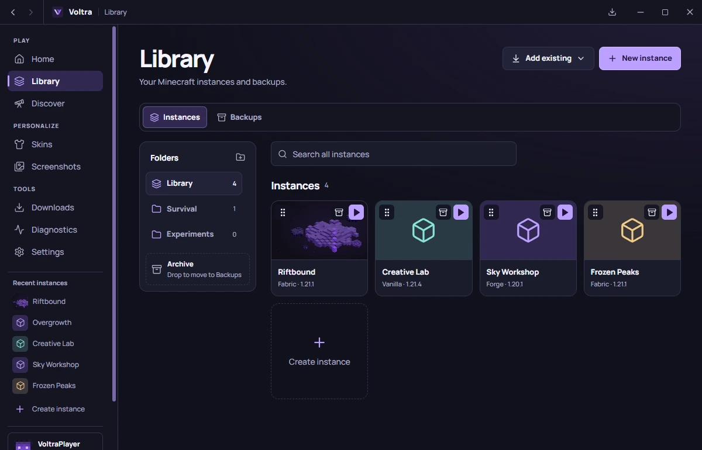

<h1 align="center">
  
</h1>

<p align="center">Open-source launcher for modded Minecraft Java Edition.</p>

<p align="center">
  <a href="https://github.com/zwroe/Voltra/releases"><strong>Releases</strong></a>
  &nbsp;·&nbsp;
  <a href="https://voltra.lol/docs/#install">User guide</a>
  &nbsp;·&nbsp;
  <a href="https://voltra.lol/docs/#build">Developer guide</a>
</p>



## Features

- Browse mods, modpacks, shaders, and resource packs from Modrinth and CurseForge. Filter by Minecraft version and loader.
- Keep each instance’s mods, settings, and saves separate. Run Vanilla, Fabric, Quilt, Forge, and NeoForge with managed Java.
- Take pack snapshots, test changes in a temporary instance, and inspect launch logs.
- Host a Vanilla or Fabric server from an instance and manage players, add-ons, and the live console.

| Discover | Server manager |
| --- | --- |
| [](docs/images/voltra-discover.webp) | [](docs/images/voltra-server.webp) |

## Build from source

Use Node.js 22 or newer, Rust, and the [Tauri prerequisites for your operating system](https://v2.tauri.app/start/prerequisites/).

```sh
npm ci
npm run tauri dev
```

On Windows, run `npm run tauri build` to create the installer.

[MIT License](LICENSE) · Independent launcher for Minecraft Java Edition.
